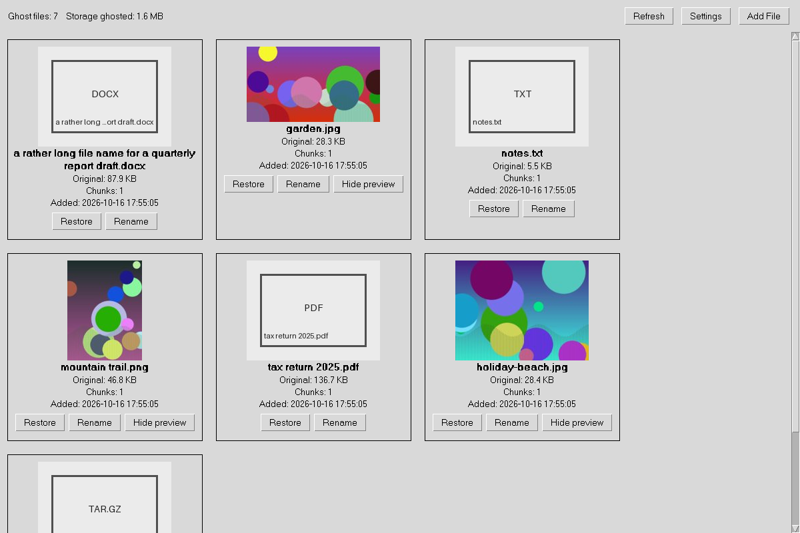

# GhostVault

GhostVault moves files off your computer into your own private GitHub repositories,
encrypted, and brings them back when you need them.

It splits a file into chunks, encrypts each chunk on your computer, uploads the chunks,
checks on GitHub that every chunk arrived intact, and only then removes the original. The
file is now a *ghost*: a card in GhostVault's window. *Restore* downloads and checks the
chunks, writes the file to a folder you choose, and removes its copy from GitHub.



The keys stay on your computer: GitHub only ever receives ciphertext, and your GitHub
tokens are kept in your operating system's keychain.

## Before you use it

- **A ghost is the only copy of the file**, unless you keep others. GitHub stores the
  encrypted chunks, and GhostVault cannot bring back what GitHub no longer has: a deleted
  repository, a suspended account, a lost token without access. GitHub's own documentation
  says Git "is not designed to serve as a backup tool". Do not ghost files you cannot afford
  to lose without another copy.
- **The keys are in GhostVault's data folder.** If you lose this computer without a recovery
  file or the repository backup, nobody can decrypt your ghosts. Prepare for that from the
  start (*Settings → Recovery*).
- **Your use of GitHub is subject to GitHub's terms**, including its limits on repository
  size, request rates and bandwidth. GhostVault follows GitHub's request limits, and
  [SECURITY.md](SECURITY.md#where-the-protection-ends) quotes what GitHub may do about
  excessive use.

## Download

Releases have a ready-to-run application for each system, and a Python package:

| System | Download |
| --- | --- |
| Windows 10 and 11, 64-bit | `GhostVault-<version>-windows-x64-setup.exe` (installer) or `-portable.zip` |
| macOS, Apple silicon | `GhostVault-<version>-macos-apple-silicon.dmg` |
| macOS, Intel | `GhostVault-<version>-macos-intel.dmg` |
| Linux, x86-64 | `GhostVault-<version>-linux-x86_64.tar.gz` |
| any system with Python 3.11+ | `ghostvault-<version>-py3-none-any.whl` |

[INSTALL.md](INSTALL.md) explains how to check a download against `SHA256SUMS.txt`, install
it, open a build that is not code-signed, set up a repository and a token, and use the
command-line options.

## How GhostVault protects your files

- **The original is removed last, and only if that is safe.** GitHub's branch must show
  every chunk under the exact content id GhostVault uploaded, and the first chunk and one
  other in each repository are downloaded and compared. Then the original is moved to a hidden name and checked
  there: if it changed, was replaced, has other hard links or is a link itself, it is kept
  and you are told why.
- **Remote chunks are removed last.** A restored file is written under a hidden name,
  checked, flushed to disk, and given its final name without ever replacing an existing
  file. Only then is its copy removed from GitHub.
- **Every interruption is recoverable.** Each ghost's record says how far its operation
  got. If GhostVault is closed, crashes or loses power in the middle of one, the next start
  finishes or undoes it, and says what it did.
- **Network trouble is expected.** Failed requests are retried with backoff, GitHub's rate
  limits are waited out (the progress line says until when), and a reply lost on the way
  back is resolved by reading the repository, never by guessing.
- **Private by default.** The data folder, its records, the encrypted previews and the log
  are readable only by you. Restored files get back their permissions and timestamps.
- **Changes are detected.** Every chunk is bound to its file, position and size; a chunk
  that was changed, swapped or removed on GitHub makes the restore fail without writing
  anything under the file's name.

What GitHub can and cannot learn about your files, and where the protection ends, is in
[SECURITY.md](SECURITY.md).

## Where your chunks go

By default GhostVault **distributes** each file's chunks over all your repositories. You can
choose **consolidated** placement instead, so that all of a file's chunks go to one
repository, as the default or for one file, and choose which repositories may be used
(*Settings → Storage and privacy*). Distributed spreads storage, but a file then needs every
repository holding one of its chunks; consolidated makes a file depend on one repository.
Neither keeps a second copy. The comparison is in
[docs/ARCHITECTURE.md](docs/ARCHITECTURE.md#storage-placement).

**Padding** (on by default, *Enhanced privacy*) fills each file's last chunk with random
bytes, so that GitHub sees a file's size only to within 512 KiB. *Storage efficiency* turns
it off for new files.

## Recovering your ghosts

Prepare, in *Settings → Recovery*:

- **Save recovery file…** writes an encrypted file with every ghost's key and chunk map,
  protected by a passphrase. Keep it away from this computer. It covers the ghosts that
  exist when you save it; Settings tells you when newer ghosts are in no recovery file.
- **Turn on repository backup…** keeps the same information, encrypted, in each of your
  repositories, updated after every change. You are shown a recovery key once: write it
  down. Git keeps every earlier version of the backup, so whoever later learns that key and
  can read your repositories can read the keys of files you have since restored.

On a new computer: install GhostVault, add your repositories with their tokens (*Settings →
GitHub*), then *Open recovery file…* or *Recover from repository backup…* (*Settings →
Recovery*), and restore your files as usual. A forgotten passphrase or recovery key cannot
be reset. Details: [docs/CRYPTO_AND_RECOVERY.md](docs/CRYPTO_AND_RECOVERY.md).

## Using the window

| Key (Cmd on macOS) | Action |
| --- | --- |
| Ctrl+O | Add File |
| Ctrl+, | Settings |
| F5 or Ctrl+R | Refresh |
| Ctrl+Q | Quit (asks first while an operation runs) |
| Tab, Return or Space | move between buttons and press them |
| Page Up / Down, Home, End, mouse wheel | scroll |
| right-click, Shift+F10 | a card's menu: Restore, Rename, preview, Copy name |
| Escape | close a dialog or Settings |

Names, paths, messages and recovery details can be selected and copied. Recovery keys stay
hidden until you press *Show*, and are copied only when you ask; a copied key is taken off
the clipboard again after a minute. More in [docs/GUI.md](docs/GUI.md).

## How long it takes

GitHub asks applications to send write requests one at a time, at least a second apart, and
limits how much content an account may create per minute and per hour. GhostVault follows
that, so ghosting takes at least one second per 512 KiB chunk, and a large file can reach
GitHub's hourly limits, in which case GhostVault waits and then continues. Restoring
downloads up to eight chunks at a time. Encryption is not the bottleneck: on the computer
measured in the technical report, AES-256-GCM ran at about 1,600 MiB/s.

## Documentation

- [INSTALL.md](INSTALL.md): installing, first steps, data folder, command-line options
- [SECURITY.md](SECURITY.md): what is protected, from whom, and the limits
- [docs/ARCHITECTURE.md](docs/ARCHITECTURE.md): the journal, safe deletion and restoration, GitHub
- [docs/CRYPTO_AND_RECOVERY.md](docs/CRYPTO_AND_RECOVERY.md): keys, chunks, previews, recovery
- [docs/GUI.md](docs/GUI.md): the interface
- [docs/TESTING.md](docs/TESTING.md) and [docs/INTEGRATION_TESTING.md](docs/INTEGRATION_TESTING.md): the tests
- [report/ghostvault-report.pdf](report/ghostvault-report.pdf): *GhostVault: Encrypted File
  Storage Across Private GitHub Repositories*, the system design and implementation report
- [RELEASING.md](RELEASING.md): building and releasing the applications
- [CHANGELOG.md](CHANGELOG.md)

## Development

```
python -m venv .venv
.venv/bin/python -m pip install -e ".[dev]"     # Windows: .venv\Scripts\python ...
.venv/bin/python -m pytest                       # Linux without a desktop: xvfb-run -a ...
.venv/bin/python -m ghostvault
```

```
src/ghostvault/     the application (the core modules do not import Tk)
tests/              the test suite, with an in-memory model of the GitHub API
packaging/          the standalone builds: PyInstaller spec, build script, installers
tools/              measurements, a crash-and-fault stress run, screenshots
report/             the technical report (LaTeX source and PDF)
docs/               design documentation
assets/icons/       the application icons
.github/workflows/  CI on Windows, macOS and Linux; the release build
```

## License

MIT; see [LICENSE](LICENSE). The standalone applications include third-party software
under their own licenses, listed in `THIRD-PARTY-NOTICES.txt` inside each application.
