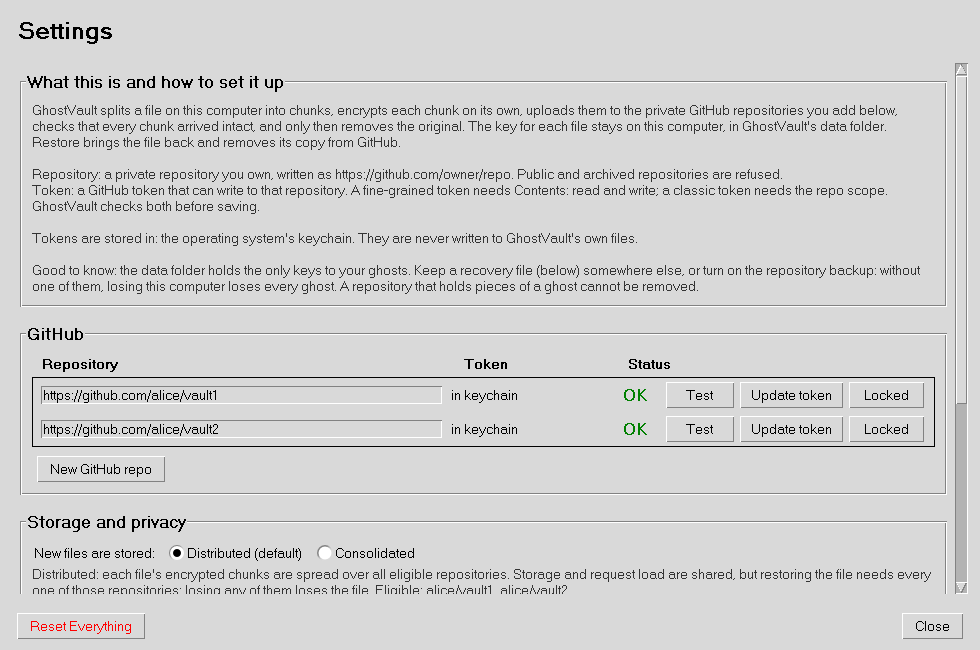

# The interface

GhostVault's window has a bar with the statistics and three buttons, a progress area that
appears while something runs, and a gallery of cards, one per ghost. Settings is a second
window of titled sections. Both use classic Tk widgets. This page is the visual reference
the interface keeps to, and describes how it behaves.

## Visual reference

The values are collected in `src/ghostvault/gui/style.py`, so that every part of the
interface uses exactly the same ones.

| Element | Value |
| --- | --- |
| Widgets | classic Tk (`tk.Button`, `tk.Label`, `tk.LabelFrame`, `tk.Scrollbar`); the progress bar is ttk |
| Main window | 900 x 600; statistics on the left; Refresh, Settings, Add File on the right; 10 px around the bar |
| Progress | bar and a grey detail line above the gallery, only while an operation runs |
| Card | 1 px solid border; 8 px inside; 10 px around; thumbnail 200 x 150; name in Arial 11 bold; "Original", "Chunks", "Added" lines; buttons below (5 px above and below) |
| Empty gallery | "No ghost files yet. Click Add File." in Arial 16 |
| Placeholder tile | light grey (235), dark 3 px frame from (20, 20) to (180, 130), the file type, the name at the bottom |
| Settings | 980 x 650; "Settings" in Arial 18 bold; sections in `LabelFrame`s titled in Arial 12 bold; Reset Everything (red) and Close at the bottom |
| GitHub table | column titles in Arial 10 bold; rows in a 1 px solid box; status in Arial 13 bold: green check, red cross |
| Colours | body text #333333; secondary grey; pending #a05000; errors red; verified green |
| Dialogs | Tk's simple dialog layout (prompt, field, OK and Cancel 10 characters wide); Tk's message box layout (icon left, text right, button below) |

## Layout

- Every card has the same width, that of the widest fixed content (the thumbnail or the
  button row), and the cards in a row are equally tall, so the columns line up.
- The number of columns follows the window's width, so no card is ever cut off.
- A long name wraps inside its card (up to three lines). The whole name is in a tooltip, is
  selectable, and is in the card's right-click menu.
- The placeholder tile of a file without a preview shows the file type, centred, and the
  name shortened with an ellipsis in the middle ("a rather long …ort draft.docx");
  `.tar.gz` is shown as TAR.GZ.
- Dates are shown in local time.
- A refresh keeps the cards that did not change, so nothing flickers and the scroll
  position stays.
- In the GitHub table of Settings, the column titles are aligned with the measured columns,
  and the status falls back to "OK" / "X" where the font cannot draw the check mark and
  cross; the check result is in a tooltip.

**Scaled displays.** Tk sizes fonts in points, so text follows the display's resolution,
but sizes given in pixels do not. Every pixel size of the design (window sizes, paddings,
wrap lengths, thumbnails, scrollbars) is multiplied by the display's scale
(`style.Scale`), so at 125 %, 150 % or 200 % the proportions stay those of the 96 dpi
design. On Windows the process declares itself DPI-aware, so text is sharp. macOS works in
points already. On a screen too small for the design size at its scale, the main window and
Settings open as large as the screen allows (leaving room for the frame, title bar and
taskbar), placed on the screen, with their buttons in view.

## Selectable and copyable text

Text worth copying can be selected with the mouse or keyboard, copies with Ctrl+C (Cmd+C on
macOS), and has a right-click menu (Copy, Copy all, Select all): card names, the names and
reasons of damaged records, the texts in Settings (including the recovery status and the
ids of the records concerned), repository addresses, and every result, error and recovery
dialog. It looks exactly like a label (same font, colour and background, no border) and
cannot be edited.

Results, errors and recovery information use GhostVault's own dialogs: the layout of Tk's
message box, with selectable text and a Copy button. Yes/no confirmations are the
platform's native message boxes.

**Secrets.** Recovery keys and generated passphrases are shown once, hidden until *Show* is
pressed, and copied only by the *Copy* button (or Ctrl/Cmd+C on the revealed value), never
automatically. A copied secret is taken off the clipboard again after one minute, and when
GhostVault closes, but only if the clipboard still holds exactly that secret: anything copied
since is left alone. The clearing belongs to the application, not to the dialog, so closing
the dialog does not cancel it. The dialog states the limits: GhostVault cannot remove copies
kept by clipboard history or a clipboard manager (Windows' Win+V history, synced
clipboards), nor clear the clipboard if it stops unexpectedly. Passphrase and token fields
are masked (a *Show* box reveals a passphrase being typed), and Tk copies a masked field's
selection as asterisks; a revealed secret's selection is not exported (no X11 middle-click
paste), and copying it is cleared like the Copy button's. Secret fields are emptied when
their dialog closes.

## Responsiveness

Nothing that touches files, cryptography or the network runs on the window's thread:

- ghosting, restoring, clean-up and start-up recovery;
- adding, testing, updating and removing repositories, Reset, turning the backup on or off,
  recovery files and repairs;
- the connection check before an operation (authenticated, limited to four seconds; it
  recognises a proxy asking for a login, a sign-in page or a filter answering instead of
  GitHub, and a certificate that is not GitHub's);
- renaming and hiding previews (they can update the repository backup);
- previews: local ones are decrypted within a small time budget on the window's thread, the
  rest, and any that must be downloaded, on a background pool, replacing the tile when ready.

The window title shows the running operation and its percentage (also in the taskbar).
Closing the window during an operation asks first; if you confirm, the process ends at once
with the data folder still locked, and the next start finishes or undoes the operation from
its journal, exactly as after a crash.

## Keyboard and mouse

| Key | Action |
| --- | --- |
| Ctrl+O (Cmd+O) | Add File |
| Ctrl+, (Cmd+,) | Settings (macOS: also the application menu's Settings) |
| F5, Ctrl+R (Cmd+R) | Refresh |
| Ctrl+Q (Cmd+Q) | Quit (asks first while an operation runs) |
| Tab, Shift+Tab | move between buttons; the gallery scrolls to the focused card |
| Return or Space | press the focused button |
| Page Up / Down, Home, End | scroll the gallery or Settings |
| Escape | close a dialog, or Settings |
| Ctrl+W (Cmd+W) | close Settings |
| Shift+F10, the menu key, right-click | a card's menu: Restore, Rename, Show/Hide preview, Copy name |

Settings takes the keyboard focus when it opens and gives it back to the main window when it
closes. The mouse wheel and touchpad scroll the gallery and Settings on every platform
(Windows and macOS deltas, X11 buttons 4 and 5, Tk 8.6 and 9). The buttons' tooltips name
their shortcuts.

## Names and folders

Add File, Rename and Restore ask in one dialog that shows the locked extension beside the
field (typing it too is fine) and checks the name before anything starts: characters no
system allows, a name too long for any file system (at most 255 bytes; the vault refuses it
too, without a raw operating-system error), a name already in the gallery, a file already in
the restore folder. The problem is shown in the dialog, which stays open. Restore shows the
destination folder, with *Change...*; Add File offers this file's storage placement. The
last folders used are remembered for the session.

## Cards and Settings

- **Cards:** Restore, Rename, Show/Hide preview; Retry clean-up for a ghost whose remote
  copy is still being removed; a damaged record's card leads to *Settings → Recovery*.
- **Settings → GitHub:** the repositories, their status and tokens: add, test, update the
  token, remove (only a repository that holds no ghost).
- **Settings → Storage and privacy:** placement (distributed or consolidated), the
  repositories used for new files, padding (*Enhanced privacy* or *Storage efficiency*),
  whether new image files get a preview, and clearing cached previews. These apply to files
  ghosted from then on.
- **Settings → Recovery:** saving and opening recovery files, the repository backup, and,
  when records are unreadable or missing, *Repair from repository backup...*, *Repair from
  recovery file...* and *Set aside...*, with the ids concerned; *Update repository backup
  now* when it is pending.

## Errors and the log

An unexpected error in an interface callback is shown, and logged by its type and where it
happened (file name, line and function of the innermost frames), never with its message,
which can hold a file name, a path or a secret. The log file's formatter applies the same
rule to any traceback. GhostVault's own icon is used for the window and the taskbar. On
Linux the window's X11 class is `ghostvault` / `Ghostvault`, which the menu entry made by
`install.sh` names, so desktops group the window with it.

## Platforms

| | Windows | macOS (Intel and Apple silicon) | Linux |
| --- | --- | --- | --- |
| Sharp text on scaled displays | DPI-aware process; pixel sizes scaled | native (points) | pixel sizes scaled from the X server's dpi |
| Shortcut key | Ctrl | Cmd; Settings and Quit in the application menu | Ctrl |
| Wheel | `MouseWheel` (120 per notch) | `MouseWheel` (Tk 8.6 small steps, Tk 9 like Windows) | buttons 4/5 (Tk 8.6), `MouseWheel` (Tk 9) |
| Context menu | right-click, menu key, Shift+F10 | right-click, Control-click | right-click, menu key, Shift+F10 |
| Confirmations | native message boxes | native | Tk's |

The GUI tests run on all three systems in CI, with Tk 8.6 and Tk 9.

## Screenshots

`tools/screenshots/shoot.py PROJECT OUTDIR` captures every view of a source tree against the
simulated GitHub (the sample files are generated; nothing touches the network);
`compare.py` puts two sets side by side, and `shoot_scaled.py` captures the window on a
scaled display. The docstrings give the `xvfb-run` command lines. The screenshots on this
page were captured that way on Linux, under Xvfb, with Tk's X11 core fonts; a desktop with
anti-aliased fonts draws the same layout with smoother text.

## Accessibility limits

Tk exposes little to screen readers on any platform, and GhostVault cannot change that
without leaving Tk. What it does: every action is reachable by keyboard, the focus is
visible and kept in view, text can be selected, and the colours keep their contrast.
